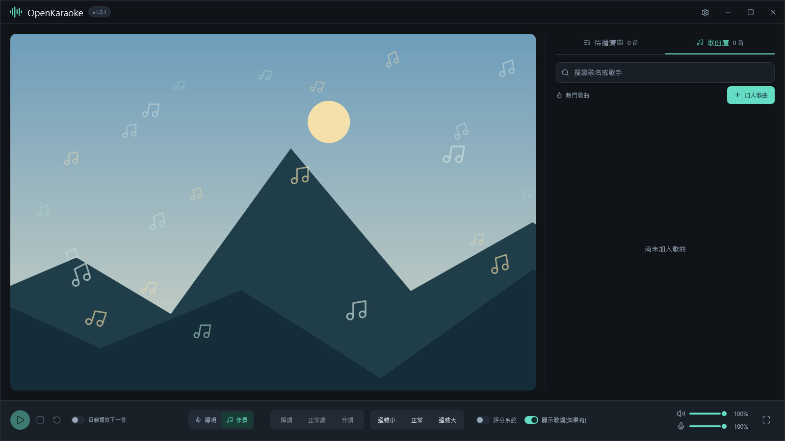

<div align="center">


# OpenKaraoke

**在家，也能好好唱一首歌。**

Windows 桌面 K 歌軟體，從製作伴唱、點歌演唱，到錄音與音準回顧。

 [](LICENSE)

[功能](#功能) · [開始使用](#開始使用) · [使用指南](#使用指南) · [常見問題](#常見問題)

</div>



## 功能

- **製作自己的伴唱歌曲**：從 YouTube 網址製作歌曲，在本機分離導唱與伴奏；也能匯入 `.opok` 歌曲，並相容舊的 `.openkaraoke`。
- **點歌與管理歌庫**：搜尋歌名或歌手、安排待播順序，支援重唱及自動下一首。
- **調整演唱音效**：切換導唱／伴奏、升降調與迴聲，支援全螢幕演唱。
- **匯入同步歌詞**：加入歌曲時可匯入歌詞，選擇滾動或 KTV 逐字顯示，並在「設定 → 顯示」調整字體大小。
- **用電腦或手機收音**：電腦音訊輸入與手機來源二擇一；手機不需安裝 App，最多兩支共同演唱。
- **查看音準表現**：旋律音條隨歌曲捲動，音符完成後呈現紅綠結果，提供三種評分難度。
- **回顧這次演唱**：同步聆聽音樂與人聲錄音、查看音準記錄，並可下載錄音。

## 開始使用

到 [Releases](https://github.com/tm3u/OpenKaraoke/releases/latest) 下載 Windows x64 執行版，再依下列步驟開始使用：

1. **開啟程式**：完整解壓縮 `OpenKaraoke-Standalone-win-x64.zip`，執行最外層的 `OpenKaraoke.exe`，不需另外安裝 .NET。請保留隨附資料夾。
2. **加入歌曲**：匯入 `.opok` 或舊的 `.openkaraoke`，或輸入 YouTube 網址、歌名與歌手，加入處理清單。
3. **開始演唱**：歌曲完成後按「＋」加入待播清單，再按播放。

首次製作會下載必要 AI 元件，需要網路與數 GB 空間；處理清單會獨立顯示元件準備進度。AI 在本機執行，支援時使用 NVIDIA GPU，否則使用 CPU。已有歌曲可離線播放、搜尋及匯入。

## 使用指南

[加入歌曲](#加入與管理歌曲) · [演唱控制](#演唱控制) · [評分與回顧](#評分與回顧) · [麥克風設定](#麥克風設定) · [手機設定](#手機麥克風設定) · [資料與備份](#資料與備份)

### 加入與管理歌曲

按「加入歌曲」選擇製作或匯入：

- **製作歌曲**：輸入 YouTube 網址，按「讀取影片」，確認歌名與歌手後加入處理清單。只取得完整原片，忽略網址的時間、區間及清單參數；Clip 分享網址會解析為原片。
- **匯入歌曲**：選擇 `.opok` 或舊的 `.openkaraoke` 檔案。程式會在自己的資料目錄建立 `歌名_歌手.opok` 副本，之後不依賴原始匯入檔案的位置。既有歌庫中的 `.openkaraoke` 仍可播放，不會自動更動原檔。

歌名與歌手會清除前後空白，保留中間空格。歌曲工作依序處理，可取消或重試；關閉視窗仍會繼續背景處理，重新啟動可接續未完成工作。

「加入歌曲」的歌名、歌手下方可選填歌詞，支援 `.lrc` 與 `.ass`。呈現方式為二擇一：左側「滾動歌詞」預設選取（多行捲動、目前句醒目顯示，逐行時間即可），右側「KTV 逐字」（固定雙行、逐字填色，需要完整逐字或音節時間）。歌詞與模式會封裝在 `.opok` 歌曲檔內，可離線播放；匯入已包含歌詞的新舊歌曲檔時沿用原有歌詞與模式。

有歌詞的歌曲會在 `media/<歌曲編號>/` 另存與歌曲同名的獨立副本：滾動歌詞為 `歌名_歌手.lrc`，KTV 逐字為 `歌名_歌手.ass`，以加入時選定的呈現方式決定格式。格式不同時僅轉換原有文字與時間資料，原始檔案不會被改動。獨立副本供檢視、備份與外部管理；播放仍使用 `.opok` 內的歌詞，修改副本不會自動套用。

歌詞僅能在加入歌曲時匯入。當次未匯入，加入後無法補加；已有歌詞亦不提供更換、編輯、搜尋下載或自動製作功能。請僅匯入您有權使用的歌詞檔案。

首次製作時，「必要 AI 元件」會獨立顯示下載與安裝進度，相依歌曲排在後方等待。元件不能取消，失敗可重試；準備完成後不會重複下載。

### 演唱控制

在歌曲列按「＋」加入待播清單，成功後短暫顯示勾選。未搜尋時顯示熱門前十首，可搜尋歌名或歌手；待播歌曲可調整順序或移除。

| 控制 | 行為 |
| --- | --- |
| 播放／暫停／下一首 | 演唱中播放或暫停，結算後切換為下一首；沒有待播歌曲時回到待機。 |
| 切歌 | 結束本首並進入結算，捨棄當次評分與錄音，不影響先前紀錄。 |
| 重唱 | 從頭開始，先顯示歌名與歌手三秒，歌曲靜音且沒有倒數提示。每首歌曲開始時亦有相同準備時間。 |
| 自動播放下一首 | 預設關閉；啟用後在結算停留十秒，再接續下一首。手動按下一首可立即接續。 |
| 導唱／伴奏 | 切換歌曲音軌。 |
| 顯示歌詞(如果有) | 控制匯入歌詞的顯示／隱藏，與評分系統分別設定；狀態會保存並沿用到下一首。 |
| 升降調 | 範圍 −6～＋6 半音；中央「正常調」恢復原調。 |
| 迴聲 | 調整人聲迴聲；中央「正常」恢復預設的適量迴聲。 |
| 喇叭／麥克風音量 | 底部兩列控制範圍為 0～100，立即生效並保存。兩支手機共用麥克風音量。 |

主歌曲不提供時間跳轉，要從頭演唱請使用「重唱」。

「設定 → 顯示」可調整歌詞字體大小（75%～125%，預設 100%），適用於 KTV 逐字與滾動歌詞。按「套用」後立即更新目前歌詞並保存；取消或關閉設定會捨棄本次調整。

快捷鍵：F11 全螢幕、Esc 離開全螢幕、空白鍵播放／暫停／下一首、Ctrl+1／2 導唱／伴奏、Ctrl+↑／↓ 升降調、Ctrl+0 正常調。輸入文字時不攔截空白鍵。

### 評分與回顧

評分只計音準，演唱中不公布分數。五條背景線與固定唱歌線協助判讀音高；每條參考音符分析完成後，依整條有效樣本的平均音高偏差，固定顯示綠色或紅色。

成績為「唱準的時間 ÷ 全部參考音符的時間 × 100」，四捨五入為整數，滿分 100 分。長音依時間取得較多分數，唱準一部分可取得對應分數。共同演唱時，每個時間格合併各路有效音準後只計一次。難度為休閒／進階／專業，預設休閒；在設定套用後，從下一首或重唱生效，同一輪演唱不會中途變更難度。

唱完後顯示歌名、歌手、分數與音準記錄。已播放列的「回顧演唱」整合分數、灰色參考音條、紅綠結果及錄音。錄音包含當次歌曲音樂與監聽人聲，不錄入其他程式音訊；可播放、暫停、拖曳定位及下載，音條跟隨錄音時間軸。缺少錄音或仍在合成時會顯示實際狀態。

回顧期間會暫停歌曲、現場監聽及自動換歌計時；關閉後恢復監聽與剩餘計時。

評分基準由人聲分離及 SwiftF0 音高模型建立，再依音高、信心值及可用的音量資訊分段。既有歌曲會沿用原有音高資料重新分段。自動分析仍可能受和聲、殘留音樂或喇叭回灌影響。

### 麥克風設定

到「設定 → 語音」選擇電腦輸入或手機麥克風，正式來源二擇一。電腦收音會持續監聽，不依賴歌曲或評分是否開啟；手機最多兩支共同演唱。監聽音量與迴聲不修改原始評分訊號。

選擇手機麥克風後會自動準備兩個 QR Code，手機可先掃描連線。準備連線不切換正式來源；原本使用電腦時，按「測試收音」才會試聽手機人聲，按「套用」才正式使用。停止測試會保留手機連線；取消或關閉則撤銷本次暫時連線。原本已使用手機時會維持既有服務，網路草稿則在測試或套用後才切換。

設定中的來源、音量、網路、延遲補償及難度先保留為草稿。按「測試收音」可預覽來源、音量及網路，測試中可繼續調整；停止測試恢復正式收音，取消或關閉亦捨棄草稿。只有「套用」正式生效並保存；失敗會還原原設定並保留草稿供修正。測試人聲不加入正式評分或錄音。

延遲補償調整評分時間對齊，音量計不呈現該效果，也不會縮短監聽聲音本身的延遲。實際延遲取決於手機、網路與音效裝置，需在目標裝置驗證。

使用手機前，請依下方步驟安裝並信任憑證，再連接及測試收音。

### 手機麥克風設定

<details>
<summary>展開電腦準備、iPhone 憑證安裝與連接步驟</summary>

#### 電腦準備

1. 手機與電腦連到同一個可互通的 Wi-Fi／區域網路。訪客 Wi-Fi 或裝置隔離可能阻擋連線。
2. 到「設定 → 語音」選「手機麥克風」，確認顯示的是手機可連到的電腦網路位址。
3. 等待自動準備連線，出現「首次設定」與「連接麥克風」兩個 QR Code；準備失敗時可按「重新準備連線」。

#### iPhone 安裝與信任憑證

1. 用相機掃描「首次設定」，在 Safari 開啟設定頁，下載這台電腦的 `OpenKaraoke-Local-CA.cer`。
2. 開啟 iPhone 的「檔案」App，到下載項目找到憑證並點一下。Safari 下載完成不代表已安裝。
3. 開啟「設定 → 已下載描述檔」，選擇該憑證並按「安裝」；沒有此入口時，到「設定 → 一般 → VPN 與裝置管理」查看。依系統提示輸入手機密碼完成安裝。
4. 到「設定 → 一般 → 關於本機 → 憑證信任設定」。
5. 在「針對根憑證啟用完整信任」下，開啟 **OpenKaraoke Local Microphone CA** 的開關並確認。只安裝描述檔、未開啟完整信任，仍可能出現私人連線警告或無法連線。

憑證只應信任自己電腦提供的版本，可核對設定頁的指紋。若描述檔已過期而未安裝，請重新下載後再操作。

#### 連接與套用

1. 安裝並信任憑證後，掃描第二個「連接麥克風」QR Code。
2. 在 Safari 允許使用麥克風，開啟網頁的麥克風開關。
3. 在電腦按「測試收音」，對手機說話並確認有反應；第二支手機可依相同步驟連接。
4. 在電腦按「套用」，將手機設定作為正式來源。若按取消，會恢復原來源與設定。

收音成功後，網頁會要求螢幕常亮並顯示實際狀態。系統不支援、低耗電、切換 App 或手動鎖屏仍可能中斷連線，不能保證阻止手動鎖屏。

手機收音使用本機 HTTPS／WSS（加密網頁與音訊連線）。程式不自動修改防火牆或安裝系統憑證；移到其他 Windows 使用者或電腦會產生新憑證，手機需重新設定信任。

</details>

### 資料與備份

設定左下角「歌曲庫與紀錄」開啟目前資料目錄，預設為 `%LOCALAPPDATA%\OpenKaraoke`。資料獨立於執行程式，更新版本不會清除歌曲。

<details>
<summary>展開資料內容、備份與搬移方式</summary>

| 路徑 | 用途 |
| --- | --- |
| `library.db` | SQLite 歌曲庫、點播次數及清單偏好。 |
| `media/<歌曲編號>/歌名_歌手.opok` | 自有歌曲副本，含影片、導唱、伴奏、評分基準及匯入的歌詞；既有的 `.openkaraoke` 仍相容。 |
| `media/<歌曲編號>/歌名_歌手.lrc` 或 `.ass` | 獨立歌詞副本；滾動使用 `.lrc`，KTV 逐字使用 `.ass`，沒有歌詞時不建立。 |
| `performances/<演唱編號>/` | `recording.m4a` 錄音與 `performance.json` 評分資料。 |
| `voice-settings.json` | 音訊、評分及自動播放設定。 |
| `creation/jobs.json` | 尚未完成的製作與匯入工作。 |
| `scoring/` | 評分基準快取。 |
| `phone/` | 手機連線憑證資料。 |
| `artifacts/player.log`、`error.log` | 執行錯誤紀錄。 |

可指定其他資料位置：

```powershell
./OpenKaraoke.exe --data-dir "D:\OpenKaraoke-Data"
```

AI 元件預設另存於 `%LOCALAPPDATA%\OpenKaraoke\ai`，不隨 `--data-dir` 改變，可用 `--ai-dir` 指定；首次使用下載，需數 GB 空間。

重新啟動會清空待播與本次已播放列，保留歌庫、偏好及錄音。備份時先關閉程式，再複製整個資料目錄；搬移後以 `--data-dir` 開啟。資料異常時會保留復原備份與錯誤紀錄，未備份前請勿刪除資料庫。

</details>

## 常見問題

<details>
<summary>解壓後的檔案用途</summary>

```text
OpenKaraoke.exe          啟動程式
app/                    隨附的執行環境與程式依賴
tools/                  媒體工具、模型與製作腳本
docs/                   標誌與畫面圖片
licenses/               第三方授權
README.md               功能與使用指南
LICENSE                 軟體授權
THIRD-PARTY-NOTICES.md   第三方元件聲明
```

執行環境已隨附，啟動時不會額外解壓一份 .NET。請保留 `app/` 與 `tools/`；歌曲及錄音預設另存於使用者資料目錄。

</details>

<details>
<summary>手機一直讀取、出現憑證警告或無法收音？</summary>

- **首次設定一直讀取**：確認手機與電腦網路互通，電腦防火牆允許此程式的連線。憑證設定預設使用 HTTP 8080。
- **私人連線或憑證警告**：確認已信任目前這台電腦的根憑證，尤其是 iPhone 的完整信任開關；收音預設使用 HTTPS 8443。
- **網址有頁面但不能收音**：使用包含 `https://` 的「連接麥克風」網址，並確認 Safari 麥克風權限。

iPhone 憑證的下載、安裝與完整信任步驟見[手機麥克風設定](#手機麥克風設定)。

</details>

<details>
<summary>歌曲、錄音與設定存在哪裡？</summary>

預設存放於 `%LOCALAPPDATA%\OpenKaraoke`，與程式目錄分開。設定左下角的「歌曲庫與紀錄」可開啟目前資料目錄，更新程式不會清除歌曲。

重新啟動會清空待播清單與本次已播放列，保留歌庫、偏好及錄音。自訂資料位置與備份方式見[資料與備份](#資料與備份)。

</details>

<details>
<summary>可以離線使用嗎？</summary>

已有歌曲可離線播放、搜尋及匯入；從 YouTube 製作歌曲與首次準備 AI 元件需要網路。手機麥克風仍需與電腦保持區域網路連線。

</details>

## 授權與合法使用

Copyright (C) 2026 tm3u

本專案的自有程式碼、文件與素材採 [GPL-3.0-only](LICENSE)，第三方元件依各自授權，詳見[第三方聲明](THIRD-PARTY-NOTICES.md)。

本專案不附帶歌曲、MV 或商業歌曲庫。請僅處理自有、已取得所需授權或依法允許利用的內容，並遵守來源平台條款。完整聲明見[授權與合法使用](THIRD-PARTY-NOTICES.md#專案授權與合法使用)。

---

[使用指南](#使用指南) · [建置與封裝](docs/BUILD.md) · [問題回報](https://github.com/tm3u/OpenKaraoke/issues) · [第三方聲明](THIRD-PARTY-NOTICES.md)

回報問題請附重現步驟、程式與 Windows 版本及錯誤訊息，勿附私人歌曲、錄音、憑證私鑰或存取權杖。
